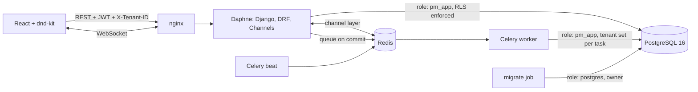

# Multi-tenant SaaS Project Manager

**A Jira-style Kanban SaaS where one organisation's data can't reach another's, even if the application code has a bug, because PostgreSQL enforces the boundary itself.**

[](https://github.com/Alkarim786/multitenant-saas-project-manager/actions/workflows/ci.yml)


## The problem

Most SaaS products keep all customers in one database with a `tenant_id` column. It's cheap and simple, but a single forgotten `WHERE tenant_id = ?` shows one company's data to another. The usual defence is code review, and it only has to fail once.

This project keeps that cheap shared schema and adds a second, independent wall. Application code scopes every query, and PostgreSQL row-level security (RLS) also refuses any row outside the current tenant. Raw SQL that forgets the filter returns nothing from other tenants.

On top of that sit the hard parts of a real collaborative board: role-based permissions, drag-and-drop ordering that rewrites one row, conflict detection when two people move the same card, live updates over WebSockets, background jobs and an append-only audit log.

## Architecture



### How a card move flows

```mermaid
sequenceDiagram
    participant A as Alice's browser
    participant D as Django
    participant P as PostgreSQL
    participant R as Redis
    participant O as Bob's browser
    A->>A: Show the move immediately
    A->>D: POST /api/issues/7/move/ {column, before, after, version}
    D->>D: Verify JWT and membership in X-Tenant-ID
    D->>P: set_config('app.tenant_id', tenant)
    D->>P: BEGIN, SELECT issue FOR UPDATE
    alt version is stale
        D-->>A: 409 with the current state
        A->>A: Reload the board and explain
    else version matches
        D->>P: UPDATE one row (rank, column, version), INSERT audit, COMMIT
        D-->>A: 200 with the new state
        D->>R: Publish after commit
        R-->>O: issue.moved
    end
```



## Tech stack

| Layer | Choice | Why |
|---|---|---|
| API | Django 5.2, DRF | Mature ORM and migrations, and permissions fit naturally into the view lifecycle |
| Auth | SimpleJWT | Stateless, and works for both REST and the WebSocket handshake |
| Tenancy | Shared schema with PostgreSQL RLS | Cheap per tenant like a shared table, with database-enforced isolation |
| Real time | Django Channels, Redis | Shares auth and models with the API, and Redis lets it scale past one process |
| Jobs | Celery, Redis | Exports and reminders run outside the request, with retry on worker loss |
| Frontend | React, TypeScript, dnd-kit | Accessible drag and drop; board logic is pure functions, so it's unit tested |
| Delivery | Docker Compose, nginx, GitHub Actions | One command to start, and CI tests on real Postgres and Redis |

## Features

- **Organisations:** sign up to create one, belong to several, and switch between them.
- **Two-layer tenant isolation:** ORM scoping plus RLS, failing closed when no tenant is set.
- **Roles:** Owner, Admin, Member, Viewer, tested as a full matrix. An organisation can't lose its last owner.
- **Kanban board:** projects, columns, issues (`WEB-12`), priorities, points, assignees, due dates and comments.
- **Fractional ranking:** a move rewrites one row, with automatic rebalancing if ranks ever collide.
- **Conflict detection:** a stale version gets a 409 with the current state, for both moves and edits.
- **Live updates:** sent only after commit, so a rolled-back change is never announced. Clients reconnect with backoff and reload to catch up.
- **Audit log:** before and after values for each change, and append-only at the database level.
- **Background jobs:** CSV export with spreadsheet formula-injection protection, and hourly due-date reminders.

### Roadmap

- Invitations by email (today, a member must register first)
- Closing open sockets when a member is removed (today, access is checked on connect)
- Editable columns and sprints
- Profiling and multiple server processes, since throughput is currently low (see Benchmarks)
- Connection pooling (PgBouncer in transaction mode needs `SET LOCAL` instead of session settings)

## Decisions and trade-offs

**Shared schema with RLS, not one schema or database per tenant.** Separate databases isolate best, but migrations and connections multiply with every customer. Shared tables with RLS scale cheaply. The cost is that a noisy tenant can affect others, and a per-tenant backup restore is harder.

**Two layers instead of RLS alone.** The ORM layer gives clear behaviour and returns nothing early. RLS catches whatever the ORM layer misses. Tests run as the unprivileged role, so they exercise both.

**The app must not connect as the table owner.** PostgreSQL superusers bypass RLS, and that's the easiest way to think this feature works when it doesn't. Migrations run as `postgres`; web and workers run as `pm_app`, which has `NOBYPASSRLS`. The migration also sets `FORCE ROW LEVEL SECURITY`.

**Session setting, not `SET LOCAL`.** The tenant is stored on the connection for the whole request, so views don't need to run inside one long transaction. The cost is that it must be reset when the request ends, and it isn't compatible with transaction-mode pooling.

**Fractional ranks instead of integer positions.** Integer positions rewrite every card below a drop, which means more locks and more conflicts. A string key between two neighbours touches one row. Keys slowly lengthen, so collisions or exhaustion trigger a rebalance of that column.

**Optimistic version checks instead of locks held across a drag.** A person may hold a card for seconds, so no lock is held during the drag. The check and the write happen together inside a short `SELECT FOR UPDATE`.

**Token in the WebSocket query string.** Browsers can't set headers on WebSockets. The token is short-lived and nginx access logging is turned off for that path. A one-time ticket endpoint would be stronger, but it's more moving parts for this project.

## Quick start

```bash
cp .env.example .env
docker compose up -d --build
docker compose exec web python manage.py seed
```

Open <http://localhost:3000> and sign in as `owner@acme.test`, or `admin@`, `member@` or `viewer@`, with the `SEED_PASSWORD` from your `.env`. A second organisation is at `owner@globex.test`.

To watch live updates, open the board in two windows and drag a card in one.

### Local development

```bash
docker compose up -d postgres redis
cd backend
python -m venv .venv && .venv/Scripts/pip install -r requirements-dev.txt   # bin/pip on Linux and macOS
export DJANGO_SECRET_KEY=dev DB_USER=postgres DB_PASSWORD=postgres_dev
python manage.py migrate
export DB_USER=pm_app DB_PASSWORD=pm_app_dev
python manage.py runserver
```

```bash
cd frontend
npm install
npm run dev
```

## API reference

Every endpoint except register, token and refresh needs `Authorization: Bearer <jwt>`. Tenant endpoints also need `X-Tenant-ID`. A tenant you don't belong to returns 404, so its existence isn't confirmed.

| Method | Path | Minimum role | Purpose |
|---|---|---|---|
| POST | `/api/auth/register/` | Public | Create a user and organisation |
| POST | `/api/auth/token/`, `/api/auth/token/refresh/` | Public | Get or refresh tokens |
| GET | `/api/me/` | Signed in | Your user and organisations |
| GET | `/api/projects/` | Viewer | List projects |
| POST, PATCH, DELETE | `/api/projects/{id}/` (POST on the list) | Admin | Manage projects |
| GET | `/api/projects/{id}/board/` | Viewer | Columns, issues and members |
| POST | `/api/projects/{id}/export/` | Member | Queue a CSV export (202) |
| GET | `/api/exports/{id}/`, `/api/exports/{id}/download/` | Member | Export status and file |
| GET | `/api/issues/?project={id}` | Viewer | List issues |
| POST, PATCH, DELETE | `/api/issues/{id}/` (POST on the list) | Member | Manage issues; `expected_version` gives 409 if stale |
| POST | `/api/issues/{id}/move/` | Member | `{column, before, after, version}`; 409 if stale |
| GET, POST | `/api/issues/{id}/comments/` | Viewer, Member | Read or add comments |
| GET, POST, PATCH, DELETE | `/api/members/` | Viewer to read, Admin to change | Manage members |
| GET | `/api/audit-log/` | Admin | Audit entries, newest first |
| WS | `/ws/boards/{project}/?token=&tenant=` | Viewer | `issue.created`, `issue.updated`, `issue.moved`, `issue.deleted`, `comment.created` |

## Testing

```bash
docker compose up -d postgres redis
cd backend
. ../scripts/test-env.sh
TEST_REDIS=1 pytest
```

```bash
cd frontend
npm test
```

**83 backend tests and 12 frontend tests.** They run on real PostgreSQL as the unprivileged role, so RLS is really enforced. They cover:

- Cross-tenant reads and writes on each kind of endpoint, plus referencing another tenant's columns or users
- RLS on raw SQL: filtered reads, zero rows with no tenant, rejected foreign inserts, updates that touch nothing
- The full role matrix, owner protection and the append-only audit log
- 3,000 random rank insertions, move ordering, one-row writes, 409s and rebalancing
- Live delivery after commit, no delivery after rollback, and socket rejections
- Export idempotency, formula-injection protection, and reminders sent once

Testing the running stack also found a bug the in-memory channel layer had hidden: redis-py's default socket timeout dropped every idle WebSocket about every 5 seconds. It's now fixed, with a regression test against real Redis that CI runs too.

## Benchmarks

Measured with `scripts/bench.py` through the full path (nginx, one Daphne process, PostgreSQL, Redis, all in Docker Compose).

**Hardware:** AMD Ryzen 5 7520U laptop, 16 GB RAM, Docker Desktop on Windows 11 (WSL2, 8 CPUs, 7.4 GB). **Conditions:** on battery, with other apps running; total CPU load was 54-63% around the run. These aren't numbers from a tuned server.

| Measurement | p50 | p95 | p99 | Throughput | Samples |
|---|---|---|---|---|---|
| Card move, 1 client | 99.1 ms | 150.5 ms | 202.3 ms | 9 moves/s | 300 |
| Card move, 16 concurrent clients on separate cards | 898.9 ms | 1228.4 ms | 1424.3 ms | 17 moves/s | 288 |
| Move request sent to WebSocket message received | 104.9 ms | 145.8 ms | 188.2 ms | n/a | 100 |

**Same-card race:** in 20 rounds of 16 clients sending the same version for one card, exactly 20 moves succeeded and the other 300 got a 409. No lost updates and no other status codes.

**Reading these honestly:** isolation and correctness held, but throughput is low. This setup runs one Daphne process and opens a new database connection for each request (`CONN_MAX_AGE=0`), which are the first things I'd change, although I haven't profiled it to confirm where the time goes. The 16-client numbers show requests queueing rather than a usable production capacity.

## Project structure

```
backend/
  config/            settings, URLs, ASGI and Celery setup
  core/
    tenancy.py       tenant context, scoped manager, tenant base model
    permissions.py   tenant activation and role checks
    ranking.py       fractional index keys
    services.py      create and move issues, audit, post-commit broadcast
    views.py         REST API
    consumers.py     WebSocket board updates
    tasks.py         CSV export and due-date reminders
    migrations/      0002 creates the role, grants and RLS policies
    management/      seed command
  tests/             isolation, RBAC, board, jobs, real-time, Redis
frontend/
  src/
    boardState.ts    pure board logic, unit tested
    Board.tsx        Kanban board, live updates, issue panel
    App.tsx          sign-in, organisations, members, audit log
    api.ts           REST client with token refresh
  nginx.conf         serves the app, proxies /api and /ws
scripts/
  bench.py           real latency measurements
  test-env.sh        test environment variables
docker-compose.yml
.github/workflows/ci.yml
```

## License

MIT. See [LICENSE](LICENSE).
